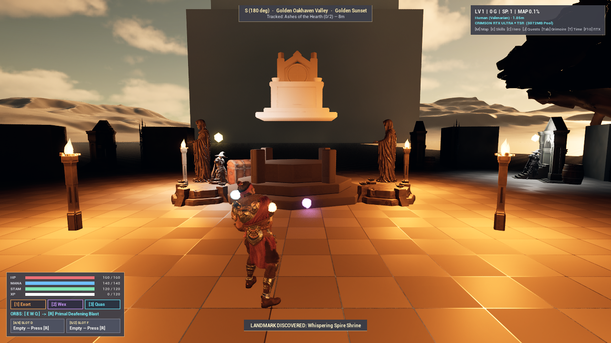
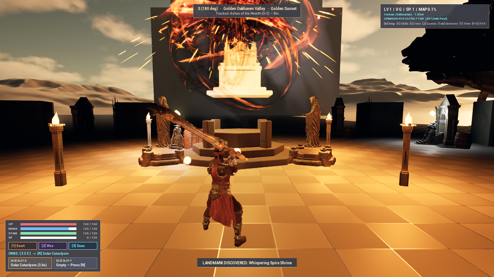
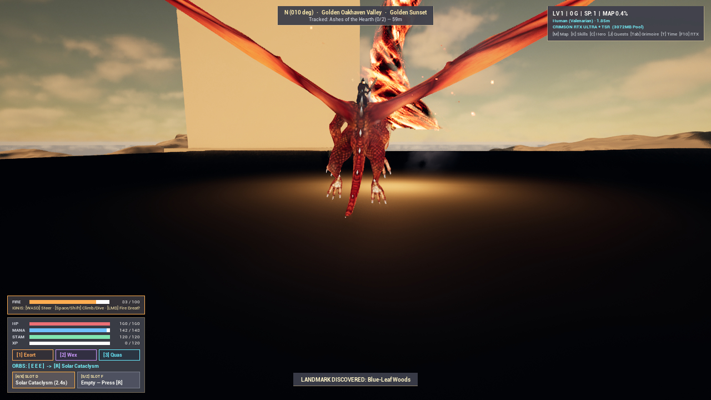
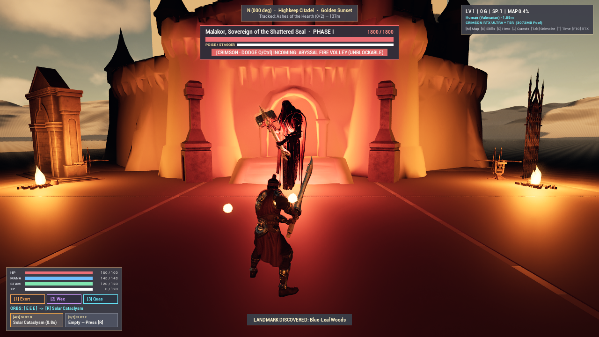
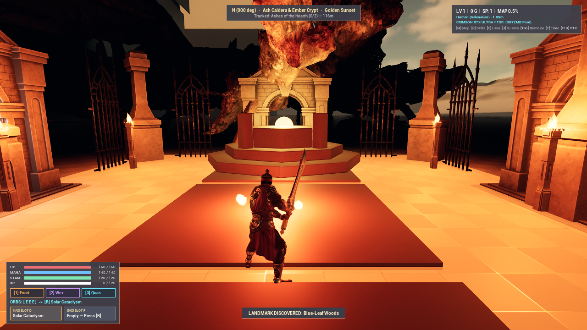
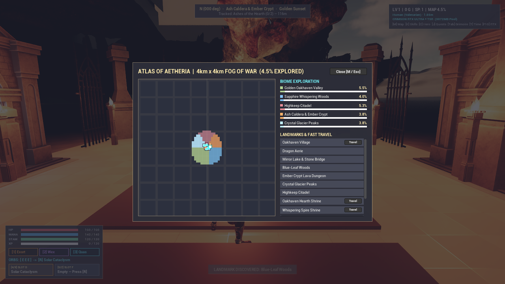
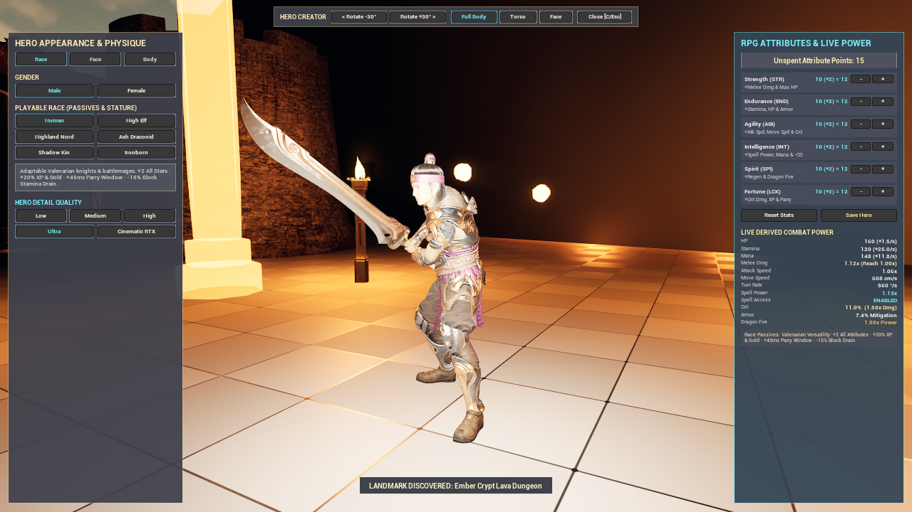

# Aetheria: Chronicles of the Drake (UE 5.8.4 C++)

Open-world 1–6 Player Co-op Action-RPG built in **Unreal Engine 5.8.4 C++**, targeting the grounded atmospheric realism of ***Crimson Desert*** and the crisp telegraphed boss combat & hit-stop feel of ***Black Myth: Wukong***.

## Showcase (Live RTX 3070 · D3D12 SM6 · Hardware Ray Tracing Lumen + Nanite)

| Oakhaven Sunlit Plaza | Invoker SunStrike (Niagara) |
|---|---|
|  |  |

| Riding Dragon Ignis | Sovereign Boss Malakor (`SevarogBloodred`) |
|---|---|
|  |  |

| Ember Crypt Lava Hall | 4km × 4km Fog-of-War Atlas |
|---|---|
|  |  |

### Live 3D Hero Customizer, 6 Gameplay Races, RPG Attributes & Stature Physics (`1.10m – 3.00m`)

---

## Key Features
- **Hardware RTX Auto-Detection & Fallback:** Automatically enables `CrimsonRTXUltra` (HWRT Lumen, Nanite, VSM, Reflex, TSR/DLSS, 3 GB pool) on RTX GPUs, and gracefully drops to `ClassicPerformance` (1.5 GB pool, fast shadows) on non-RTX GPUs or `-nortx`.
- **Detailed Live 3D Hero Customizer (`[C]`):** Male & Female AAA Paragon rigs (`Kwang`, `Gideon`, `Khaimera`, `Serath`, `Kallari`, `Morigesh`), 6 Races, Hair/Mustache/Beard/Eyes/Tattoos/Outfits/Colors, Detail Quality (`Low` → `Cinematic RTX`), Musculature, Shoulders, and Height (`1.10m – 3.00m`) with live rotating portrait camera.
- **Physical Stature & Scale Gameplay:**
  - **Small (`< 1.45m`):** Lower melee damage & HP, **primal spellcasting physically locked**, compensated by rapid movement, agile turning (`720–860°/s`), and cheaper dodges.
  - **Giant Titan (`2.26m – 3.00m`):** Massive melee damage (`up to 1.78×`), reach (`1.48×`), stagger (`1.90×`), and HP (`+68%`), traded off against heavy clumsy turning (`down to 185°/s`), slower swings/movement, and higher dodge stamina cost.
- **6 Gameplay-Transforming Races:** `Human`, `High Elf`, `Highland Nord`, `Ash Draconid`, `Shadow Kin`, and `Ironborn` — each applying real racial attribute offsets and live combat/exploration/dragon passives.
- **Full Working RPG Attribute System:** `STR`, `END`, `AGI`, `INT`, `SPI`, `LCK` (+15 starting points, +3 per level up), replicated in multiplayer and persisted via `SaveGame`.
- **Quest-Gated Progressive Invoker Spellcasting:** Unlock `Exort` (1 spell) → `Wex` (4 spells) → `Quas` (all 10 combinations) across 6 story quests.
- **Rideable Fire-Breathing Dragon Ignis:** Mounted 3D flight with bone-aligned `DragonTheUsurperSK` rig, `P_ky_fireStorm` fire breath, and aerial Fog-of-War discovery.
- **Wukong-Style Boss Combat (`SevarogBloodred`):** Amber parryable (`RMB`) vs Crimson unblockable (`Dodge`) telegraphs, poise/stagger bar, and dilation-safe `UHitStopSubsystem`.
- **5-Biome 4km × 4km Open World & 1–6 Player Co-op:** Oakhaven Valley, Mirror Lake & Arched Stone Bridge, Sapphire Whispering Woods, Highkeep Citadel, Ash Caldera & Ember Crypt, and Crystal Glacier Peaks.

## Build & Run
> Third-party Epic Fab asset packs (`Paragon*`, `FourEvilDragonsHP`, `Gothic_props_1`, `TA_Sample_Statue`, `DarkRuins`, `Free_Spells`, `FXVarietyPack`, `Whisper`, etc.) are excluded from Git via `.gitignore` and should be staged locally in `Content/`.

1. Run `BUILD_AETHERIA_CHRONICLES.bat` (auto-detects Unreal Engine 5.8).
2. Run `PLAY_AETHERIA_CHRONICLES.bat` (or pass `-nortx` for standard non-RTX mode).
3. See [`README_PLAY_GUIDE.md`](README_PLAY_GUIDE.md) for complete Russian controls & co-op instructions.
